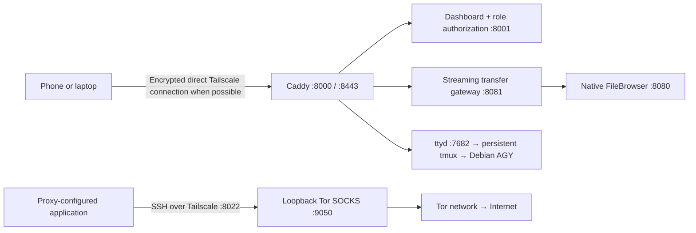

# Redmi server operations

This repository captures the running non-root Redmi K20 Pro setup. It updates an **already provisioned** Termux/Termux:API/Termux:Boot installation with Caddy, native FileBrowser v2.63.23, Tor, tmux, and a Debian proot containing AGY and LibreOffice. It does not contain user data, passwords, signing keys, databases, certificates, AGY history, or account tokens.

## Connections



Tailscale negotiates encrypted peer connections; its coordination service is not the website host. Relays remain the automatic fallback when a network prevents direct connectivity. Do not disable that fallback and assume every future carrier/router will permit direct UDP. Direct IPv6 connectivity was verified between the laptop and Redmi on the tested mobile-data path. Files are not sent through Tor.

Caddy serves the website and authenticates each protected route. FileBrowser trusts a proxy identity header, so its backend and the admission gateway must stay bound to loopback. Privileged routes use a dedicated admin authorization endpoint, including encoded/mixed-case URL variants. Keep the dashboard, ttyd, Tor, and backend listeners private. Port 8000 is HTTP; Tailscale encrypts it on the tailnet, while a local LAN connection needs HTTPS for transport protection. Caddy's internal CA needs to be trusted by browsers for :8443; no public CA certificate is provisioned here.

## Update and credentials

On the development machine:

```sh
cd gateway
GOOS=linux GOARCH=arm64 CGO_ENABLED=0 go build -trimpath -o ../.work/mobile-gateway .
```

Copy this checkout and `.work/mobile-gateway` to the phone, then run `bash scripts/install.sh` **inside Termux**. The installer validates Caddy, migrates the legacy dashboard credentials if necessary, updates code, reloads Caddy, restarts the dashboard/gateway/battery monitor, and preserves existing disabled-service flags. It defaults Tor off on its first installation. Existing FileBrowser databases/configuration, Debian tools, wallpaper, recovery jobs, guardian, and terminal HTML are prerequisites and are not recreated. This is a device-specific deployment: review the hardcoded Termux home, tailnet address, and LAN addresses before using another device.

Password records live only in `~/.config/dashboard/users.json` (mode 600). PBKDF2-HMAC-SHA256 uses a random salt and 600,000 iterations. The migration verifies that existing passwords still match. Change a password from an interactive Termux shell:

```sh
server-user astro                 # hidden input; existing role is preserved
server-user newname --role family # also provision corresponding FileBrowser user/scope
```

Login throttling bounds failed attempts and concurrent password verification. The dashboard never restores a plaintext password fallback. Old source copies containing passwords must be removed/redacted separately; restoring a legacy dashboard would restore the old flaw. Session signing keys are private runtime files. Password changes do not currently revoke all issued 30-day sessions: disable the account to reject them immediately, or rotate the private dashboard session key and restart the dashboard to sign everyone out.

## Upload limits

The browser queue accepts six files at once (previously two). Each resumable TUS resource keeps a single stream. The gateway allows six writes per authenticated user, eight globally, and twelve reads globally, and rejects duplicate simultaneous PATCH writes to the same decoded TUS resource. Excess requests receive 429 with Retry-After. Existing FileBrowser TUS retries remain enabled. Maximum declared file size is 64 GiB and a TUS PATCH is limited to 16 MiB; FileBrowser currently uses 2 MiB chunks. These are admission limits, not a reserved disk quota: incomplete resumable uploads can still consume storage, so monitor free space and abandoned uploads.

Files stream through bounded buffers. Caddy and the gateway use 60-second read/write idle deadlines and at most 64 accepted connections. Caddy supports full-duplex HTTP/1 responses so rejected uploads return errors promptly. Fixed five-minute whole-file deadlines were removed. The dashboard permits 32 request handlers, two screenshot uploads (25 MiB each including multipart overhead), and one conversion (32 MiB / ten inputs). Each conversion has a private LibreOffice profile and a bounded process lifetime. Conversion outputs still use memory; complex documents can need more memory than their input size.

## Tor proxy

Enable **Tor SOCKS Proxy** in the admin dashboard. A service enable is not proof of working Tor: the UI shows an exit only after a real HTTPS check reports `IsTor: true`; unavailable/stale checks cannot claim verified egress. The local proxy was tested successfully against Tor Project's exit check.

On a laptop with SSH access to the server:

```sh
ssh -N -L 9050:127.0.0.1:9050 -p 8022 u0_a505@100.75.159.53
curl --proxy socks5h://127.0.0.1:9050 --noproxy '' https://check.torproject.org/api/ip
```

Configure the application's SOCKS5 host as `127.0.0.1`, port `9050`, with DNS through the proxy (SOCKS5h). If that local port is occupied, choose another local forwarding port. Leave server/tailnet file transfers outside the proxy. This tunnel requires the laptop's SSH connection to stay running. Tor stays bound to loopback and is not an open relay.

**Full-device internet routing through the server and Tor is unavailable in this implementation.** Turning this on does not change a device's VPN, make the Redmi's own applications use Tor, or route Tailscale exit-node traffic through Tor. Tor does not carry ordinary UDP, and the installed non-root Android VPN app has no supported setting for that forwarding chain. Proxy use also does not guarantee anonymity for an application that bypasses its proxy or identifies its user.

## Recovery and AGY persistence

`server-up`, `server-down`, `server-restart`, and `server-health` control the supervisor. Deliberate service disable flags and a deliberate global stop are respected. Termux:Boot starts it; the persisted Android JobScheduler job is a recovery fallback and may be deferred by Android. Service health failures trigger bounded retries with backoff and rotated logs. AGY shutdown removes the exact runner's descendants as well as its tmux pane to avoid orphaned proot processes.

The Android-shell guardian runs independently of Termux and USB after being launched. `scripts/phone-server-guardian.sh` is its source; it must be launched as Android shell (for example through ADB), not as Termux UID. It recovers missing Termux/Tailscale apps and a persistently unresponsive gateway, while respecting `/sdcard/.phone-server-paused`. The guardian itself ends on phone reboot. Always-on VPN, MIUI autostart/No restrictions, Termux:Boot, and the persisted job help reboot recovery; a non-root app cannot guarantee survival against every Android/OEM kill or power-off. A powered-off phone cannot be restarted by a program inside that phone.

AGY uses one named `agy` tmux session. Browser disconnects detach only that client; they do not start a fresh CLI. Scroll wheel, touch swipes and page controls call an admin-only endpoint that enters tmux copy mode and reads response history; they do not send prompt-history arrow keys. Bottom returns live; composer Send first returns live and is serialized after scrolling. New AGY panes retain 50,000 lines. A browser and actual ttyd/tmux test confirmed old response text became visible while preserving the prompt.

`agy-resume EXACT-CONVERSATION-UUID` selects a saved conversation for the **next CLI start**. A running CLI keeps its current conversation. Invalid or failed IDs do not silently create another conversation. After process/app death, tmux scrollback is lost; durable AGY conversation history is separate and requires the intended exact ID. The current runner retains its pre-existing unrestricted AGY permissions, so admin website access is effectively shell access to this server. Keep accounts, devices and tailnet permissions restricted accordingly.

## Known maintenance work

The dashboard still combines HTML and Python handlers in a large file; tests cover the changed interfaces, but splitting rendering from handlers would make future changes easier. Vendored frontend bundles are version-specific: a FileBrowser update changes asset hashes and requires rebuilding/reapplying the six-file queue patch and retesting SSO/TUS. The status CLI reports supervisor state instead of guessing sensor readings. The install script updates this existing device rather than provisioning every dependency from scratch. No tested software setting can guarantee carrier upload bandwidth or immunity to an actual Android reboot/power loss.

References: [Tailscale connection types](https://tailscale.com/docs/reference/connection-types), [performance troubleshooting](https://tailscale.com/docs/reference/troubleshooting/poor-performance-tailnet), [Tor SOCKS limitations](https://spec.torproject.org/socks-extensions.html), [FileBrowser proxy authentication](https://github.com/filebrowser/filebrowser/blob/master/docs/authentication.md), [OWASP password storage](https://cheatsheetseries.owasp.org/cheatsheets/Password_Storage_Cheat_Sheet.html).
