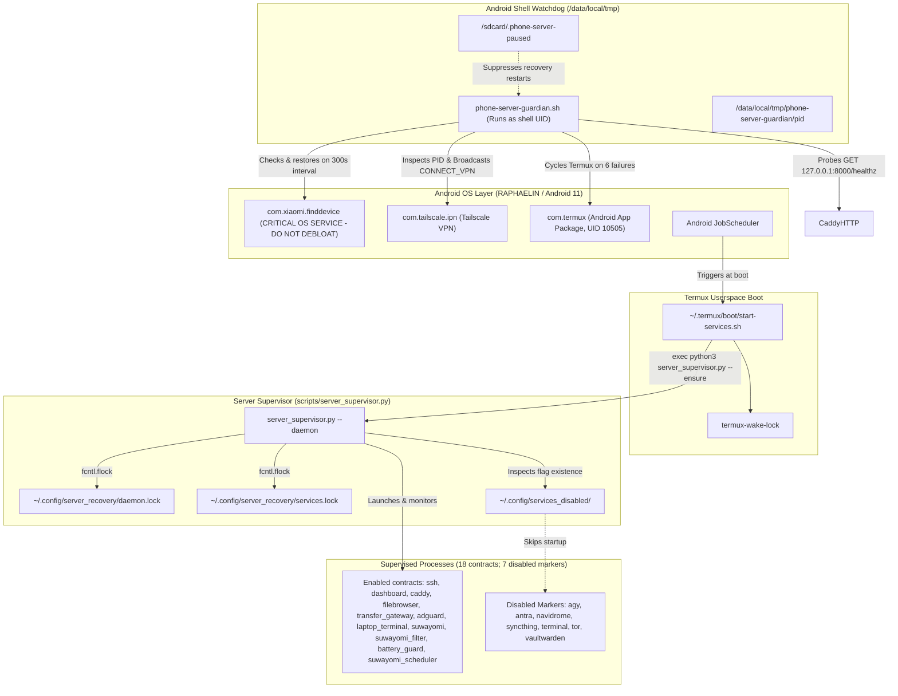
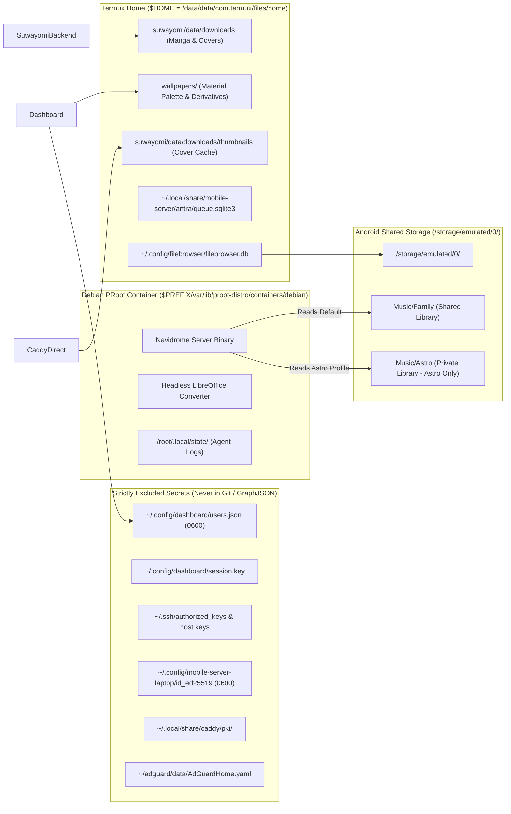

# Mobile Server Architecture & System Map

Authoritative architectural reference and navigable knowledge map for the Redmi K20 Pro mobile server deployment and its maintained repository source.
Graphify source extraction and baseline runtime inventory: **2026-11-20T13:28:31+05:30**. UI ownership, deployed source hashes, process identities, and disabled-service markers were reverified on **2026-11-25 (IST)**. The Graphify graph remains the explicitly dated baseline; the current deployment addendum below takes precedence for UI ownership and service state.

---

## 1. Architectural Overview & System Topologies

The server runs on a dedicated **Xiaomi Redmi K20 Pro (`raphaelin`)** under **Android 11 (MIUI 12.5.1)** within a non-root **Termux** environment (**UID `10505` / `u0_a505`**), backed by an independent **Android shell watchdog** and a **Debian PRoot container**. Ingress traffic is managed by **Caddy** with role-based forward authentication provided by the core **Dashboard**.

### Diagram 1: Ingress, Reverse Proxy & Authentication Routing

```mermaid
flowchart TD
    subgraph Clients["Clients & Network Ingress"]
        Browser["Web Browser (Tailscale / LAN)"]
        SubsonicClient["Subsonic Native Client (Feishin / Tempus)"]
        MangaClient["Tachiyomi / Mihon / Tsumiru"]
        SSHClient["Admin SSH Client"]
    end

    subgraph CaddyGateway["Caddy Edge Proxy (Ports :8000, :8443, :8444, :4567)"]
        CaddyHTTP["HTTP Listener :8000"]
        CaddyHTTPS["HTTPS Listener :8443"]
        CaddyWealth["Wealth Listener :8444"]
        CaddyDirect["Suwayomi Client Listener :4567"]
    end

    subgraph AuthPlane["Authentication Plane"]
        ForwardAuth["forward_auth /api/auth-check or /api/auth-check-admin"]
        Dashboard["Dashboard Core :8001 (app/dashboard.py)"]
        UsersJSON["users.json (PBKDF2 Hashes, 0600)"]
    end

    subgraph ServiceBackends["Loopback Backend Services (127.0.0.1)"]
        TransferGW["Transfer Gateway :8081 (gateway/main.go)"]
        FileBrowser["FileBrowser :8085"]
        Navidrome["Navidrome :4533 (Debian PRoot)"]
        SuwayomiFilter["Suwayomi Filter :4566 (scripts/suwayomi_graphql_filter.py)"]
        SuwayomiBackend["Suwayomi JAR :4569 (scripts/start_suwayomi.sh)"]
        AdGuard["AdGuard Home :3000 / :5353"]
        AGY["AGY Terminal :7682 (ttyd + tmux)"]
        LaptopTerm["Laptop Terminal :7683 (ttyd + ssh)"]
        LaptopTunnel["Laptop Wealth Tunnel :18930"]
        SSHDaemon["OpenSSH Daemon :8022"]
    end

    Browser -->|HTTP / HTTPS| CaddyHTTP
    Browser -->|HTTPS| CaddyHTTPS
    CaddyHTTP --> ForwardAuth
    CaddyHTTPS --> ForwardAuth
    ForwardAuth -->|Validate Session Cookie| Dashboard
    Dashboard --> UsersJSON

    ForwardAuth -->|Admin / Family Session| CaddyHTTP
    CaddyHTTP -->|/drive/*| TransferGW
    TransferGW -->|Admission Controlled| FileBrowser
    CaddyHTTP -->|/music/* (Injected Remote-User)| Navidrome
    CaddyHTTP -->|/suwayomi/* (Admin Only)| SuwayomiBackend
    Browser -->|Direct web port :3000| AdGuard
    CaddyHTTP -->|/agy/* (Admin Only)| AGY
    CaddyHTTP -->|/laptop/* (Admin Only)| LaptopTerm

    SubsonicClient -->|Native Auth Token (No Cookie)| CaddyHTTP
    MangaClient -->|Direct Sync (No Auth)| CaddyDirect
    CaddyDirect -->|POST /suwayomi/api/graphql| SuwayomiFilter
    SuwayomiFilter -->|Filtered Queries| SuwayomiBackend
    CaddyDirect -->|/suwayomi/* Assets & Covers| SuwayomiBackend
    CaddyWealth -->|Reverse Proxy| LaptopTunnel
    SSHClient -->|SSH Key Auth| SSHDaemon
```

---

### Diagram 2: Process Hierarchy, Watchdogs & Lifecycle Contracts



---

### Diagram 3: Storage, Libraries & Privacy Boundaries



---

## 2. Practical Service & Endpoint Table

Authoritative table of all **18 supervisor managed services**, **1 on-demand utility**, **1 external laptop bridge**, and **2 watchdog layers**.

| Service ID | Display Name & Category | Status (2026-11-25) | Port / Binding | Public Ingress Route | Authentication Plane | Launcher / Process Invocation | Health Probe Criteria | Code / Working Path | Config & Durable Data Paths | Privacy / Secret Level | Update & Restart Instructions |
| :--- | :--- | :--- | :--- | :--- | :--- | :--- | :--- | :--- | :--- | :--- | :--- |
| `dashboard` | Core Web Portal & Auth | **Healthy** | `127.0.0.1:8001` (HTTP) | `:8000/`, `:8443/` | Session cookie (Admin / Family) | `$PREFIX/bin/python3 -u $PREFIX/bin/dashboard` | `GET /healthz` (supervisor accepts 200, 30x, 401/403) | [`app/dashboard.py`](../../app/dashboard.py), [`app/`](../../app/) | `$HOME/.config/dashboard/users.json`, `notes.json`, `static/` | **CRITICAL**: Holds PBKDF2 user hashes & session signing keys | Update committed source; deploy via the reviewed transactional release driver (`scripts/install.sh` deliberately fails fast). |
| `caddy` | Ingress Reverse Proxy | **Healthy** | `:8000`, `:8443`, `:8444`, `:4567` | Public edge listeners | None (terminates TLS & enforces forward_auth) | `$PREFIX/bin/caddy run --config $HOME/.config/caddy/Caddyfile` | `GET /healthz` on :8000 (proxies to 8001) | [`config/Caddyfile`](../../config/Caddyfile) | `$HOME/.config/caddy/Caddyfile`, `$HOME/.local/share/caddy/pki/` | **HIGH**: Internal root/intermediate CA private keys | Reload via `caddy reload --config ...` or supervisor restart. |
| `filebrowser` | Cloud Storage & Media | **Healthy** | `127.0.0.1:8085` (HTTP) | `:8000/drive/` | Forward auth + FileBrowser token | `$PREFIX/bin/filebrowser -d .../filebrowser.db -a 127.0.0.1 -p 8085 ...` | `GET /drive/` (accepts 200, 30x, 401/403) | Precompiled binary | `$HOME/.config/filebrowser/filebrowser.db`, `fb_config.json` | **HIGH**: Application DB contains user share tokens & metadata | Do not copy DB while running. Restart via `server_supervisor.py`. |
| `transfer_gateway` | Streaming Admission Proxy | **Healthy** | `127.0.0.1:8081` (HTTP) | `:8000/drive/` proxy | Forward auth (via Caddy) | `$HOME/bin/mobile-gateway -backend http://127.0.0.1:8085` | `GET /healthz` (accepts 200) | [`gateway/main.go`](../../gateway/main.go) | Stateless admission proxy; no durable DB | **LOW**: Stateless streaming proxy | Rebuild binary via Go toolchain; stage to `.work/mobile-gateway`. |
| `suwayomi` | Manga Server Backend | **Healthy** | `127.0.0.1:4569` (HTTP loopback) | `:8000/suwayomi/*` (admin), `:4567/` (direct) | Admin forward auth or direct reader token | `$HOME/bin/start_suwayomi.sh` (Java 21 executing Suwayomi-Server.jar) | `POST /suwayomi/api/graphql` or `GET /suwayomi/` | [`scripts/start_suwayomi.sh`](../../scripts/start_suwayomi.sh) | `$HOME/suwayomi/data/`, `downloads/`, `server.conf` | **MEDIUM**: Downloaded content, reading state | Restart via supervisor; check log in `$HOME/suwayomi/data/logs/`. |
| `suwayomi_filter` | Manga GraphQL Filter | **Healthy** | `127.0.0.1:4566` (HTTP) | Direct port :4567 GraphQL route | None (internal transparent proxy) | `$PREFIX/bin/python3 $HOME/bin/suwayomi_graphql_filter.py` | `GET /healthz` (returns 200 OK) | [`scripts/suwayomi_graphql_filter.py`](../../scripts/suwayomi_graphql_filter.py) | Logs: `$HOME/suwayomi/data/logs/graphql_filter.log` | **LOW**: Transparent stream filter | Update Python source in repo; activate via installer. |
| `suwayomi_scheduler` | Daily Manga Sync | **Healthy** | None (daemon process) | Internal scheduler | None | `$PREFIX/bin/python3 $HOME/bin/suwayomi_daily_update.py --foreground` | Process match + PID file + held lock | [`scripts/suwayomi_daily_update.py`](../../scripts/suwayomi_daily_update.py) | `$HOME/suwayomi/data/scheduler.pid`, `logs/scheduler_status.json` | **LOW**: Execution logs | Runs daily at 00:00 IST. |
| `navidrome` | Music Streaming Server | **Disabled** (marker) | `127.0.0.1:4533` (HTTP) | `:8000/music/` | Caddy `Remote-User` header SSO or native token | `$PREFIX/bin/python3 -u $HOME/.local/lib/mobile-server/navidrome.py` | `GET /music/ping` (returns 302 Found) | [`app/navidrome.py`](../../app/navidrome.py), Debian PRoot | `$HOME/.config/navidrome/`, `$HOME/.local/share/navidrome/` | **MEDIUM**: Music metadata & client passwords | Keep metadata during source updates. Restart via supervisor. |
| `adguard` | Network DNS & Ad-blocker | **Healthy** | `:3000` (web), `:5353` (DNS) | Direct web port `:3000` (no Caddy route) | AdGuard internal admin login | `$HOME/adguard/AdGuardHome/AdGuardHome -c .../AdGuardHome.yaml ...` | `GET /` (accepts 200, 30x) | Precompiled binary | `$HOME/adguard/data/AdGuardHome.yaml`, query logs | **HIGH**: Admin password hash & DNS query history | Do not overwrite YAML credentials during updates. |
| `agy` | Autonomous Agent Shell | **Disabled** (marker) | `127.0.0.1:7682` (ttyd HTTP/WS) | `:8000/agy/` | Admin forward auth | `$PREFIX/bin/ttyd ... -p 7682 -b /agy ... $HOME/bin/agy_session.sh` | `GET /agy/` (accepts 200, 30x) | [`scripts/agy_session.sh`](../../scripts/agy_session.sh) | `$PREFIX/var/run/tmux-10505/default`, Debian `/root/.local/state/` | **HIGH**: Shell session access & command history | Stop runner loops before updating AGY wrappers. |
| `laptop_terminal` | Laptop Terminal Bridge | **Healthy** | `127.0.0.1:7683` (ttyd HTTP/WS) | `:8000/laptop/` | Admin forward auth | `$PREFIX/bin/ttyd ... -p 7683 -b /laptop -I $HOME/.config/ttyd/termux_index.html ... laptop_session.py` | `GET /laptop/` (accepts 200, 30x) | [`scripts/laptop_session.py`](../../scripts/laptop_session.py) | `$HOME/.config/mobile-server-laptop/id_ed25519` (0600) | **CRITICAL**: Private SSH key granting shell access to laptop | Retain pairing keys across deployments. |
| `ssh` | Remote Admin Shell | **Healthy** | `0.0.0.0:8022` (TCP) | Tailscale / USB / LAN direct | Public key authentication | `$PREFIX/bin/sshd -D` | TCP probe on port 8022 (banner `SSH-`) | Termux OpenSSH package | `$PREFIX/etc/ssh/`, `$HOME/.ssh/authorized_keys` | **CRITICAL**: Termux account shell access keys | Preserved across global server pauses (`--pause` excludes SSH). |
| `battery_guard` | Thermal & Power Guard | **Healthy** (daemon) | None (daemon process) | Internal background | None | `$PREFIX/bin/bash $HOME/bin/battery_guard.sh --daemon` | Process match + `$HOME/.config/battery_guard/status.json` mtime < 360s | [`scripts/battery_guard.sh`](../../scripts/battery_guard.sh) | `$HOME/.config/battery_guard/status.json`, logs | **LOW**: Telemetry and voltage logs | Managed by supervisor; restarts automatically. |
| `syncthing` | Continuous File Sync | **Disabled** (marker) | `127.0.0.1:8384` | Unexposed | Syncthing GUI credentials | `$PREFIX/bin/syncthing serve ...` | `GET /rest/noauth/health` | Termux Syncthing package | `$HOME/.local/state/syncthing/` (`config.xml`, `index-*.db`) | **HIGH**: Sync keys & folder index DB | Marker in `~/.config/services_disabled/syncthing`. Preserve intent. |
| `vaultwarden` | Password Vault | **Disabled** (marker) | `127.0.0.1:8082` | Unexposed | Bitwarden Master Password | `$PREFIX/bin/proot-distro login debian -- ... vaultwarden` | `GET /alive` | Debian PRoot binary | `$HOME/vaultwarden/data/` (`db.sqlite3`, RSA keys) | **CRITICAL**: Encrypted password vault database | Marker in `~/.config/services_disabled/vaultwarden`. Do not force-enable. |
| `terminal` | Admin Termux Web Shell | **Disabled** (marker) | `127.0.0.1:7681` | Unexposed | Admin forward auth | `$PREFIX/bin/ttyd ... -p 7681 -b /terminal ... termux_session.sh` | `GET /terminal/` | [`scripts/termux_session.sh`](../../scripts/termux_session.sh) | `$HOME/.config/ttyd/termux_index.html` | **CRITICAL**: Direct raw Termux shell access | Marker in `~/.config/services_disabled/terminal`. Preserve intent. |
| `tor` | Tor SOCKS Proxy | **Disabled** (marker) | `127.0.0.1:9050` | None (SOCKS5) | None (loopback client) | `$PREFIX/bin/tor -f $HOME/.config/tor/torrc` | SOCKS5 handshake (`\x05\x01\x00` -> `\x05\x00`) | [`config/torrc`](../../config/torrc) | `$HOME/.local/share/mobile-server-tor/` | **MEDIUM**: Onion routing state | Marker in `~/.config/services_disabled/tor`. Preserve intent. |
| `antra` | Music Downloader | **Disabled** (dormant) | None (worker daemon) | Admin dashboard `/antra/` | Admin role only | `$PREFIX/bin/python3 -u .../antra_worker.py` | Owned worker process | [`app/antra_worker.py`](../../app/antra_worker.py) | `$HOME/.local/share/mobile-server/antra/queue.sqlite3` | **MEDIUM**: Download queue state & provider cookies | Marker in `~/.config/services_disabled/antra`. Preserve intent. |
| `converter` | Headless PDF Converter | **On-Demand** | None (subprocess batch) | Triggered via dashboard | Admin / Family role | `proot-distro login debian -- libreoffice ... --headless` | Bounded execution (0 MB idle RAM) | [`app/document_conversion.py`](../../app/document_conversion.py) | `$HOME/data/conversions/batch_<id>/` | **LOW**: Temporary scratch conversion files | Ephemeral process; batches cleared after download. |
| `laptop_bridge` | Wealthfolio Laptop Bridge | **External Bridge** | `127.0.0.1:18930` (tunnel) | `:8444/*` | Laptop reverse tunnel | Laptop reverse SSH tunnel to phone loopback | HTTP probe on :18930 (503 page when offline) | [`config/Caddyfile:217`](../../config/Caddyfile#L217) | No phone-side database; backed by laptop | **LOW**: Proxy tunnel only | Offline fallback handled gracefully by Caddy 503 response. |
| `phone_guardian`| Android Shell Watchdog | **Active** (deployment and timer recovery verified 2026-11-20) | None (independent loop) | Internal system monitor | None | `toybox sh /data/local/tmp/phone-server-guardian.sh` | Checks Tailscale, Termux 8000/healthz (20s) and com.xiaomi.finddevice (300s) | [`scripts/phone-server-guardian.sh`](../../scripts/phone-server-guardian.sh) | `/data/local/tmp/phone-server-guardian/` | **HIGH**: Android shell permissions | Restarts Termux/Tailscale; restores com.xiaomi.finddevice; NEVER restarts Android. Honors pause marker. |
| `termux_boot` | Boot & WakeLock Handler | **Boot Trigger** | None (boot receiver) | Boot lifecycle | None | `~/.termux/boot/start-services.sh` | Acquires wake-lock; runs supervisor --ensure | [`scripts/start-services.sh`](../../scripts/start-services.sh) | `$HOME/.termux/boot/start-services.sh` | **LOW**: Boot script | Executed by Termux:Boot and Android JobScheduler on reboot. |

---

## 3. Cross-Layer Contracts vs. Observed Live Deployments

### Historical Runtime Observations (2026-11-20 Live Inventory)

These observations document the baseline, not current process state. The Nov 25 addendum supersedes the supervisor hash and AGY/Navidrome enabled state.

1. **Supervisor Hash Alignment & Deployment Manifest Drift**:
   - The live script at `/data/data/com.termux/files/home/bin/server_supervisor.py` has SHA-256 `6efb973831e91e65ca33d578fe4cb8d419d3faabf693ebdbf7dda9592fd02760`.
   - At that baseline, this matched the maintained repository file [`scripts/server_supervisor.py`](../../scripts/server_supervisor.py) byte-for-byte.
   - However, the audited baseline in [`config/deployment-files.json:39-43`](../../config/deployment-files.json#L39-L43) still records an earlier hash (`286aec0e2e224d3308d6a551d141261b27e674e8590995f2b49379b7b70388cb`). Future agent releases must regenerate candidate manifests via [`scripts/release-manifest.py`](../../scripts/release-manifest.py) rather than assuming `deployment-files.json` is fresh.

2. **Suwayomi Port & Routing Architecture**:
   - **Context-path distinction**: Static catalogs list backend port `4569` and client port `4567`. A raw GET on `127.0.0.1:4569/` returns `404 Endpoint GET / not found` because Tachidesk/Suwayomi serves its API under context prefix `/suwayomi`.
   - **Observed Reality**:
     - The Java process (`Suwayomi-Server.jar`) binds strictly to `127.0.0.1:4569`. Direct GraphQL queries to `http://127.0.0.1:4569/suwayomi/api/graphql` respond successfully with `{"data":{"__typename":"Query"}}`.
     - **Port 4567** is bound by **Caddy** (not Java!). Caddy acts as a smart edge router for native clients (Mihon, Tachiyomi, Tsumiru):
       1. Thumbnail requests (`/suwayomi/api/v1/manga/{id}/thumbnail`) are served directly from disk cache at `$HOME/suwayomi/data/downloads/thumbnails/` via Caddy's `file_server` with immutable 1-year caching.
       2. GraphQL POST requests (`POST /suwayomi/api/graphql`) are routed to `127.0.0.1:4566` (the Python filter), which enforces Reading Category 1 and skips read chapters.
       3. All other `/suwayomi*` requests proxy directly to backend `127.0.0.1:4569`.

3. **Navidrome PRoot SSO & Library Separation**:
   - Navidrome runs inside the Debian PRoot container (`$PREFIX/var/lib/proot-distro/containers/debian/rootfs`).
   - Caddy injects the `Remote-User` header based on the authenticated portal session (`astro-web` vs `family`).
   - `Music/Family` is the shared library. `Music/Astro` is private. Library selection and defaults are account-specific.
   - Native Subsonic clients (Feishin, Tempus) connect directly without portal cookies using native credentials. Caddy strips external client proxy headers to prevent spoofing.

4. **Antra Music Storage Limitation**:
   - Antra is currently dormant and disabled (`services_disabled/antra`).
   - On this device, Android emulated storage (`/storage/emulated/0/`) rejects atomic directory no-replace renames (`renameat2`). To avoid data loss or unchecked file overwrites, Antra publishes each track inside its own directory. Future maintainers must never replace this logic with a naive file overwrite.

5. **Wallpapers & Appearance Subsystem**:
   - Wallpapers are managed through an admin-only portal section. Themes are extracted via `matugen`.
   - Preparation, verification, and atomic publishing use [`tools/prepare_wallpapers.py`](../../tools/prepare_wallpapers.py) per [`docs/WALLPAPERS.md`](../WALLPAPERS.md).

6. **Xiaomi OS Bootloop Invariant & Phone Guardian Watchdog**:
   - The Nov 20 bootloop incident was resolved by restoring `com.xiaomi.finddevice`. This package is a critical MIUI OS dependency. **Never debloat or disable `com.xiaomi.finddevice`**.
   - **Audit Record (2026-11-20 13:45 IST)**: The live phone guardian was confirmed **inactive** (PID file held stale PID 9242 from Oct 22). The updated guardian was subsequently published and activated; the laptop timer successfully rearmed it during a controlled process-only recovery test.
   - **Guardian Logic**: The updated [`scripts/phone-server-guardian.sh`](../../scripts/phone-server-guardian.sh) performs an immediate initial check, then checks `com.xiaomi.finddevice` every 300s via `cmd package list packages -e --user 0 com.xiaomi.finddevice`. If absent or disabled for user 0, it restores and enables it. It restarts Termux or Tailscale; it never restarts Android.
   - **Verified Laptop USB Rearm**: A laptop-side systemd timer template ([`laptop/phone-guardian.timer`](../../laptop/phone-guardian.timer) invoking [`tools/ensure_phone_guardian.py --ensure`](../../tools/ensure_phone_guardian.py)) is installed and enabled. It checks every 2 minutes and validates/rearms the guardian under Android shell UID 2000 when the Redmi is USB-connected.
   - **Operational Limitations**: Non-root Android shell UID 2000 processes do not persist across device reboots without an external ADB host trigger. Periodic 300s polling cannot prevent an unrecoverable bootloop if `com.xiaomi.finddevice` is disabled and the phone is rebooted before the next guardian tick.
   - **Graphify Snapshot Status**: The Graphify knowledge graph (`docs/architecture/graphify-out/`) remains a pre-change baseline snapshot (dated 2026-11-20T13:46:00+05:30) to preserve stability and avoid unnecessary graph bloat for this bounded slice.

---

## 4. Path Ownership, Privacy & Namespace Conventions

### Identity & File System Boundaries
- **Termux UID**: `10505` (`u0_a505`).
- **Base Paths**: `$HOME` = `/data/data/com.termux/files/home`; `$PREFIX` = `/data/data/com.termux/files/usr`.
- **Android Shell Watchdog**: Runs as Android `shell` UID in `/data/local/tmp/phone-server-guardian`.
- **Debian PRoot Rootfs**: `$PREFIX/var/lib/proot-distro/containers/debian/rootfs`.

### Strictly Excluded Sensitive Paths (Never Commit to Git)
- Credentials & Passwords: `$HOME/.config/dashboard/users.json` (mode 0600), `$HOME/adguard/data/AdGuardHome.yaml`.
- Session Signing Keys: `$HOME/.config/dashboard/session.key`.
- SSH & Pairing Keys: `$HOME/.config/mobile-server-laptop/id_ed25519` (mode 0600), `$HOME/.ssh/authorized_keys`, `$PREFIX/etc/ssh/ssh_host_*_key`.
- TLS Certificates & PKI: `$HOME/.local/share/caddy/pki/`.
- Private Databases: `$HOME/.config/filebrowser/filebrowser.db`, `$HOME/vaultwarden/data/db.sqlite3`.
- User Media: `/storage/emulated/0/Music/Astro` (personal music), notes in `$HOME/.config/dashboard/notes.json`.

---

## 5. Future Agent Update & Deployment Instructions

To modify, update, or maintain services on this device, follow these strict rules:

1. **Maintained Source First**:
   - Author and test all changes in this repository (`/home/astro/repos/mobile-server`).
   - Never apply uncommitted, ad-hoc edits directly to the phone filesystem.

2. **Verification Suite**:
   - Run focused unit tests before proposing a release:
     ```bash
     python3 -m unittest discover -s tests -p 'test_*.py'
     ```

3. **Transactional Deployment Preparation**:
   - Generate candidate manifests using [`scripts/release-manifest.py`](../../scripts/release-manifest.py).
   - Use [`scripts/release_activation.py`](../../scripts/release_activation.py) with the reviewed Termux activation driver to validate manifests and activate transaction bundles. The legacy `scripts/install.sh` fails fast and must not be used for direct source writes.

4. **Phone Publication Boundary**:
   - Work within the user-authorized scope and validate committed artifact hashes before publication.
   - Delegated workers stage artifacts for the coordinating agent to review and publish.
   - Architecture documentation is stored at `~/server-architecture/` on the phone (directories `0700`, files `0600`, never web-served).

---

## 6. Machine-Readable Knowledge Graph & Visualization

The persistent knowledge graph and interactive visualization are generated in [`docs/architecture/graphify-out/`](graphify-out/):
- **GraphRAG JSON**: [`graphify-out/graph.json`](graphify-out/graph.json) (860 nodes, 1824 edges, machine-queryable via Graphify CLI).
- **Cluster & Cohesion Report**: [`graphify-out/GRAPH_REPORT.md`](graphify-out/GRAPH_REPORT.md) (56 communities, hub node metrics, surprising connections).
- **Interactive Visualizer**: [`graphify-out/graph.html`](graphify-out/graph.html) (HTML visualizer; its pinned vis-network library requires Internet access).
- **Runtime Snapshot**: [`runtime_snapshot.json`](runtime_snapshot.json) (sanitized live probe evidence from 2026-11-20).

To query the knowledge graph using the local Graphify CLI:
```bash
graphify god-nodes --graph docs/architecture/graphify-out/graph.json
graphify path "Service: Caddy (Edge Reverse Proxy)" "Service: Navidrome (Debian PRoot Music)" --undirected --graph docs/architecture/graphify-out/graph.json
graphify explain "Service: Suwayomi Server (Manga Backend)" --graph docs/architecture/graphify-out/graph.json
```

## 7. Current UI Ownership and Release (2026-11-25)

The initial expressive redesign was activated from source commit `11def743320a185b1a1433056b277a7af1603ee5`, transaction `act_e9558e013ace` (`COMPLETED`). All 62 manifest destinations matched after activation: 13 replacements and 49 untouched entries. Dashboard and laptop terminal restarted; the supervisor refreshed its catalog. Caddy, the exact gateway binary, and all observed Suwayomi/AdGuard process identities were preserved.

| Surface | Maintained owner | Runtime hook and access |
| --- | --- | --- |
| Admin/family dashboards, login, notes and converter dialogs | `web/admin.html`, `family.html`, `login.html`, `portal.css` | Dashboard static role templates; existing session authentication |
| Wallpaper, glass and Matugen tokens | `web/appearance.css`, `appearance.js`, `theme-tokens.css` | Existing appearance API; controls restricted to admin, theme shared with Cloud |
| Antra and Repertoire | `web/antra.*`, `web/repertoire.*`, `app/repertoire.py` | Existing portal routes and role contracts; Antra remains disabled |
| Cloud Storage | `web/filebrowser.css`, existing entry and patched module hooks | Native FileBrowser bundle through Caddy and gateway; family scope retained |
| AGY terminal chrome | `web/agy_index.html` | Existing ttyd custom index; service remains disabled |
| Termux/laptop terminal chrome | `web/termux_index.html`, `web/laptop.js`, `app/service_catalog.py` | Shared ttyd `-I` index; laptop mode hides phone image upload; terminal remains disabled, laptop enabled |
| Standalone applications excluded from redesign | Suwayomi, Wealthfolio, Navidrome, Vaultwarden, AdGuard Home, Syncthing | Existing application interfaces and runtime commands retained; dashboard cards use shared portal design |

Desktop uses three service columns by default and a 320px right aside containing laptop terminals, one AGY panel, and notes. Column preferences and responsive layouts remain available. Family has its own notes and authorized services without admin appearance, laptop, AGY, or Tor controls.

Existing live changes were reconciled into maintained source before release: `scripts/server_supervisor.py`, `scripts/suwayomi_daily_update.py`, `scripts/suwayomi_graphql_filter.py`, and `app/suwayomi_logs.py`. All four were already live and remained untouched. Current supervisor SHA-256: `2fbd45c62d8a4c9d63a2bb883ebf24a4f918ab4bd3e2579acc541e1029fdcf59`. Bounded logging is owned by `app/suwayomi_logs.py`; preserve the intentional DNS and PRoot working-directory fixes.

Live disabled markers: `agy`, `antra`, `navidrome`, `syncthing`, `terminal`, `tor`, `vaultwarden`. Publication preserved their content, mode, owner, inode, and timestamp. Do not enable them to test visual changes.

Validation and operational limits are recorded in [the deployment report](../superpowers/expressive-workbench-deployment.md). The Nov 20 machine graph and runtime snapshot remain historical artifacts; this current human-readable map is published alongside them privately at `~/server-architecture/`.

### Compact dashboard correction

The first compact follow-up used `804c875d7e724d2f5360c1c7aa4577308895f81e`, transaction `act_44783c524b6d`. The follow-up replaced only admin/family templates, `portal.css`, and `laptop.js`; only dashboard restarted. Session control APIs, all seven disabled markers, Caddy routes, supervisor catalog, and excluded service processes remain unchanged.

The header now contains compact brand/actions/profile controls. Live LAN/Tailscale fields retain their existing IDs in connection details. Metric percentages/status remain live in their footers; CPU temperature is the main CPU value. Column selection specifies an intrinsic maximum, with a three-column default and 1–4 preference. Service descriptions live in launch hints and accessible text. Laptop/AGY controls use compact session rows, full-ID titles and Session details disclosures; creation, reconnect, close and toggle semantics remain unchanged. See the deployment report for observed geometry and verification boundaries.

### Current neutral remote panels and service state colours

Neutral-surface refinements used `f69d7e8ffac0a944af6c775c394d8e9cfac11c4c`, transaction `act_c991a2f2df2e`: three asset replacements, 59 untouched entries, dashboard restart only. Laptop and AGY use the same neutral surface. The service-card tint is owned by `.svc.running[data-state="running"]` with the converter excluded; its scoped override must win against the shared glass surface rule. Matugen and the existing transparency setting supply the colour. Unknown/static family navigation state and on-demand Ready remain neutral.

New and native Session details share a compact toolbar. Session labels are reconnect links, separate Close actions preserve lifecycle rules, primary AGY protection remains, and full IDs are retained in titles. These are dashboard presentation changes; ttyd wrappers, APIs, catalogue, disabled markers, shell sessions and all standalone applications keep their previous ownership and runtime contracts.

### Current dashboard control density

Current UI assets are from `7edf70a08525151a1fb5bc3a6b9ba1cd647259a4`, transaction `act_7133077a9487`. Only `web/portal.css` changed from the neutral-panel release. `.shell` defines dashboard control density: 34px standard/New controls, 36px header icons, and 32px launch/close squares. Standalone pages and dialogs retain existing 48px defaults. The user explicitly requested these compact reference sizes; older 48px dashboard acceptance values are superseded. Native focus, accessible names, role gating, state tints and session lifecycle behaviour remain.
